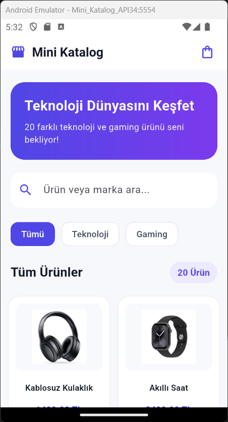
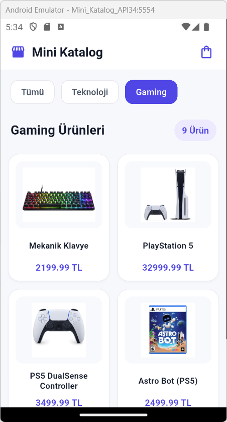
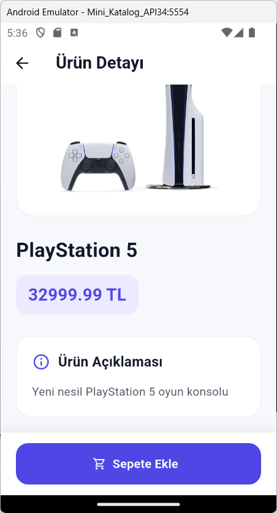
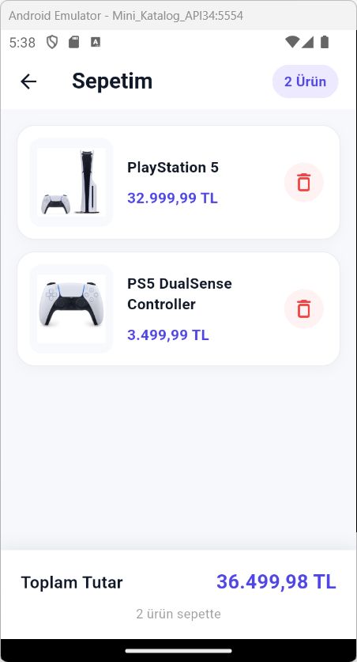
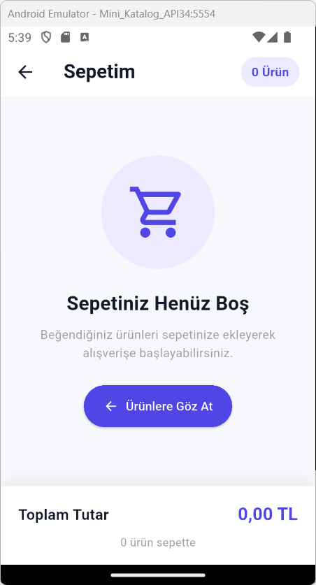

# Mini Katalog Uygulaması

Flutter ve Dart kullanılarak geliştirilmiş, teknoloji ve gaming ürünlerini listeleyen modern bir mobil katalog uygulamasıdır.

## Proje Hakkında

Bu proje, TNC Group Mobil Uygulama Geliştirme eğitimi kapsamında hazırlanmıştır.

Uygulamada toplam 20 ürün bulunmaktadır. Kullanıcılar ürünleri inceleyebilir, arama yapabilir, kategoriye göre filtreleyebilir ve ürünleri sepetlerine ekleyebilir.

Proje eğitim amaçlıdır. Gerçek ödeme veya sipariş altyapısı bulunmamaktadır.

## Özellikler

- 20 farklı teknoloji ve gaming ürünü
- Modern Material 3 kullanıcı arayüzü
- SliverGrid ile iki sütunlu ürün listeleme
- Ürün arama ve filtreleme sistemi
- Teknoloji ve Gaming kategori filtreleri
- Ürün detay sayfası
- Sepete ürün ekleme
- Sepetten ürün silme
- Sepet toplam tutarını hesaplama
- Boş sepet bilgilendirme ekranı
- JSON simülasyonu ile ürün verilerini yönetme
- Flutter Navigator ile sayfa geçişleri
- Yerel ürün görsellerinin (assets) kullanımı

## Kullanılan Teknolojiler

- Flutter 3.47.8 (Stable)
- Dart 3.13.7
- Visual Studio Code
- Android Emulator (Android 14 / API 34)
- Material Design 3

Uygulamada Flutter SDK dışında ek çalışma zamanı paketi kullanılmamıştır.

## Proje Yapısı

```text
mini_katalog_app/
├── assets/
│   └── images/
├── lib/
│   ├── data/
│   │   ├── cart_data.dart
│   │   └── product_data.dart
│   ├── models/
│   │   └── product_model.dart
│   ├── screens/
│   │   ├── cart_screen.dart
│   │   └── product_detail_screen.dart
│   ├── widgets/
│   │   └── product_card.dart
│   └── main.dart
├── screenshots/
│   ├── home.png
│   ├── gaming.png
│   ├── product_detail.png
│   ├── cart.png
│   └── empty_cart.png
├── pubspec.yaml
└── README.md
```

## Kurulum ve Çalıştırma

### 1. Gereksinimler

- Flutter SDK
- Dart SDK
- Visual Studio Code
- Android Studio ve Android SDK
- Android Emulator veya fiziksel Android cihaz

### 2. Projeyi indirme

GitHub üzerinden projeyi indirin veya klonlayın.

Proje klasörünü Visual Studio Code ile açın.

### 3. Bağımlılıkları yükleme

Terminalde aşağıdaki komutu çalıştırın:

```bash
flutter pub get
```

### 4. Cihaz bağlantısını kontrol etme

Android emülatörünü başlatın veya fiziksel Android cihazınızı bağlayın.

Bağlı cihazları görüntüleyin:

```bash
flutter devices
```

### 5. Uygulamayı çalıştırma

```bash
flutter run
```

Birden fazla cihaz bağlıysa Flutter sizden cihaz seçmenizi isteyebilir.

### 6. Kod analizi

Proje kodlarını kontrol etmek için:

```bash
flutter analyze
```

## Ürün Kategorileri

| Kategori | Ürün Sayısı |
|----------|-------------|
| Teknoloji | 11 |
| Gaming | 9 |
| Toplam | 20 |

Kullanıcılar kategori butonlarını kullanarak ürünleri filtreleyebilir.

Arama özelliği, seçilen kategoriyle birlikte çalışır.

## Veri Yönetimi

Ürün verileri, JSON yapısını simüle eden yerel `Map<String, dynamic>` listelerinde tutulmaktadır.

`Product` modeli, `fromJson()` ve `toJson()` metotları aracılığıyla veri dönüşümünü sağlar.

Sepet işlemleri uygulama belleğinde gerçekleştirilir.

Sepete eklenen ürünler görüntülenebilir, silinebilir ve toplam tutar otomatik hesaplanır.

## Uygulama Ekran Görüntüleri

### Ana Sayfa

20 ürünlü katalog, arama alanı ve kategori filtreleri.



### Gaming Kategorisi

Gaming kategorisindeki dokuz ürünün listelenmesi.



### Ürün Detayı

PlayStation 5 ürününün detay sayfası.



### Sepet

Sepete eklenen ürünlerin ve toplam tutarın görüntülenmesi.



### Boş Sepet

Sepette ürün bulunmadığında gösterilen bilgilendirme ekranı.



## Proje Amacı

Flutter widget yapısını, temel kullanıcı arayüzü tasarımını, veri modellemeyi, sayfa geçişlerini, listeleme ve state yönetimini uygulamalı olarak öğrenmek.

Bu proje, Flutter ile mobil uygulama geliştirme sürecini temel seviyede deneyimlemek ve edinilen bilgileri çalışan bir uygulamaya dönüştürmek amacıyla hazırlanmıştır.

## Kullanım Amacı

Bu proje eğitim ve portföy gösterimi amacıyla geliştirilmiştir.

Ürün bilgileri ve fiyatlar örnek veri niteliğindedir. Gerçek bir e-ticaret altyapısı veya ödeme sistemi bulunmamaktadır.
